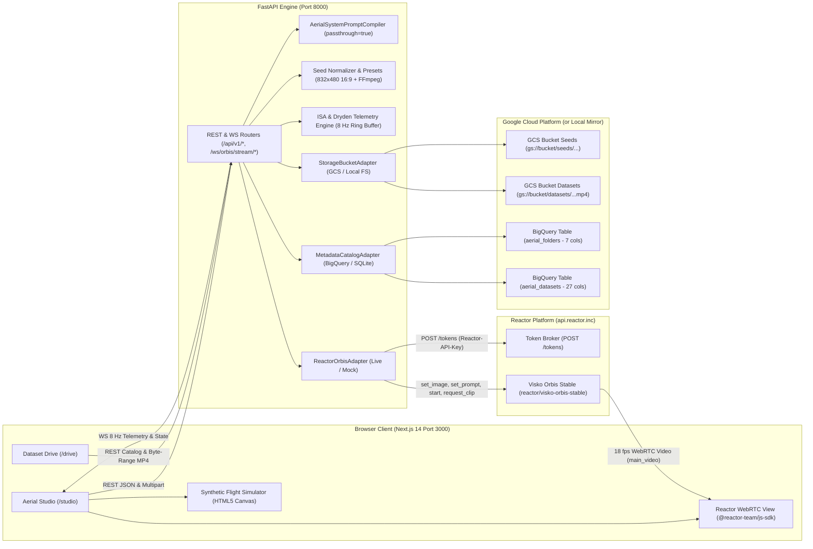
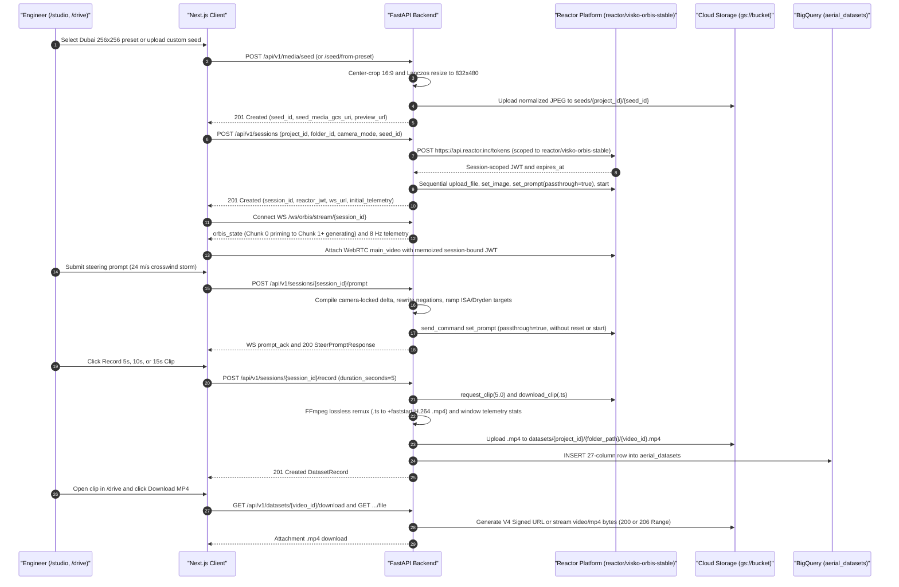

# Visko-LA — System Architecture & Agent Reference Manual

This manual serves as the authoritative technical reference for human engineers and autonomous coding agents working on the **Visko-LA Synthetic Aerial World & Telemetry Platform**. Every route, WebSocket envelope, Reactor/Visko Orbis Stable wire command, GCS URI template, BigQuery column, MCP endpoint, and multi-agent worktree convention documented below matches the verified implementation (`93/93` passing tests).

---

## 1. System Topology & Mermaid Diagrams

### 1.1 Dual-Mode Architectural Overview

Visko-LA separates domain orchestration (`AerialSystemPromptCompiler`, `SessionTelemetryEngine`, `DubaiPresetService`, `clip_recorder`) from external cloud I/O via three clean adapter boundaries in `backend/app/adapters/`:

| Subsystem | Abstract Interface | Live Cloud Adapter (`*_MOCK_MODE=false`) | Deterministic Local Adapter (`*_MOCK_MODE=true` or unconfigured) |
| :--- | :--- | :--- | :--- |
| **World Model & Auth** | `ReactorOrbisAdapter` (`orbis.py`) | `LiveReactorOrbisAdapter` (`reactor-sdk` + `POST https://api.reactor.inc/tokens`) | `MockReactorOrbisAdapter` (HS256 mock JWTs, `1.833s` chunk progression, command log, H.264 clip synthesis) |
| **Object Storage** | `StorageBucketAdapter` (`storage.py`) | `GCSStorageAdapter` (`google-cloud-storage` + V4 Signed URLs) | `LocalStorageAdapter` (`${LOCAL_STORAGE_DIR}/gcs/${GCS_BUCKET_NAME}/...` + `/file` byte-range URLs) |
| **Metadata Catalog** | `MetadataCatalogAdapter` (`catalog.py`) | `BigQueryCatalogAdapter` (`google-cloud-bigquery` parameterized SQL) | `SQLiteCatalogAdapter` (`${LOCAL_STORAGE_DIR}/bq_catalog.db` mirroring `projects`, `aerial_folders`, `aerial_datasets`) |

### 1.2 Diagram 1 — End-to-End System Topology (`flowchart LR`)



### 1.3 Diagram 2 — Session, Steering & Recording Sequence (`sequenceDiagram`)



---

## 2. Annotated Repository Map

```text
Visko-LA/
├── .env.example                          # Tracked environment variable template (Reactor, GCP, Networking)
├── .gitignore                            # Ignores .env, .venv, node_modules, .local_storage, jobs/, .agents/, jetski.json, .mcp.json
├── GETTING_STARTED.md                    # Step-by-step user onboarding (Mode A Simulator + Mode B Production Cloud)
├── SYSTEM_ARCHITECTURE.md                # Technical & AI-agent reference manual (this document)
├── README.md                             # Repository landing hub & 60-second quickstart
├── LICENSE                               # Apache 2.0 License
├── jetski.json                           # Local 6-agent orchestration roster & reactor-docs MCP config (gitignored)
├── .mcp.json                             # Local MCP server registration for reactor-docs (gitignored)
│
├── backend/                              # Python 3.11+ FastAPI Streaming, Physics & Dual-Mode Storage Engine
│   ├── pyproject.toml                    # Package metadata & Python >= 3.11 dependency specification
│   ├── requirements.txt                  # Runtime dependencies (fastapi, uvicorn, pydantic, httpx, Pillow, reactor-sdk, GCP SDKs)
│   └── app/
│       ├── main.py                       # FastAPI app factory, lifespan bootstrap, CORSMiddleware, router mounting
│       ├── config.py                     # Settings dataclass & automatic live-vs-mock credential detection
│       ├── models/
│       │   └── schemas.py                # Pydantic v2 request/response contracts, 27-col DatasetRecord, strict validators
│       ├── adapters/
│       │   ├── orbis.py                  # ReactorOrbisAdapter: LiveReactorOrbisAdapter + MockReactorOrbisAdapter
│       │   ├── storage.py                # StorageBucketAdapter: GCSStorageAdapter (V4 Signed URLs) + LocalStorageAdapter
│       │   └── catalog.py                # MetadataCatalogAdapter: BigQueryCatalogAdapter + SQLiteCatalogAdapter
│       ├── services/
│       │   ├── prompt_compiler.py        # AerialSystemPromptCompiler (3 gimbal modes, passthrough=True, negation rewrites)
│       │   ├── seed_normalizer.py        # 16:9 center-crop -> 832x480 Lanczos normalizer, FFmpeg keyframe, Dubai 256x256 presets
│       │   ├── telemetry_engine.py       # Coupled ISA barometric + Dryden/Perlin gust engine & NL weather target parser
│       │   ├── clip_recorder.py          # Strict {5,10,15}s validator, FFmpeg .ts->.mp4 remuxer, H.264 + ISO BMFF fallback
│       │   └── session_manager.py        # BackendRuntime singleton managing seeds, active Orbis sessions, and WS broadcast queues
│       └── routers/
│           ├── health_auth.py            # GET /api/v1/health, POST /api/v1/auth/reactor-token
│           ├── media.py                  # GET /api/v1/media/presets, POST /seed/from-preset, POST /seed, GET /seed/{id}/preview
│           ├── sessions.py               # GET /sessions/system-prompt, POST/GET/DELETE /sessions, POST /prompt, /seed, /record
│           ├── ws_stream.py              # WS /ws/orbis/stream/{session_id} (8 Hz telemetry + bidirectional steering)
│           └── drive.py                  # Projects, hierarchical folders, dataset search/upload/move, signed & byte-range downloads
│
├── frontend/                             # Next.js 14 (App Router) + TypeScript + Tailwind CSS Web Application
│   ├── package.json                      # Scripts (dev, build, start, lint, test) & @reactor-team/js-sdk dependency
│   ├── next.config.mjs                   # Async WebAssembly support + /api/v1/* proxy rewrite
│   ├── vitest.config.ts                  # Vitest runner discovering both src/**/*.test.* and ../tests/unit/frontend/**/*.test.*
│   ├── tailwind.config.ts                # Google Cloud Console x Visko Studio palette & typography tokens
│   └── src/
│       ├── types/api.ts                  # Strict TypeScript mirror of OpenAPI & WebSocket contracts
│       ├── lib/
│       │   ├── api-client.ts             # Typed REST & multipart client + WebSocket URL resolver
│       │   ├── jwt-cache.ts              # Memoized Reactor session JWT cache (refreshes 60s before expires_at)
│       │   ├── telemetry.ts              # Pure telemetry formatters, [0, 360) compass math, EDR severity classifier
│       │   └── drive-filters.ts          # Pure folder path normalizer, tree/breadcrumb builder, dataset filter & sorter
│       ├── context/PlatformContext.tsx   # Global health status, active project switcher, and connection badge state
│       ├── components/
│       │   ├── shell/AppShell.tsx        # Persistent top bar (gs:// + BigQuery pill, health badge) & left navigation rail
│       │   ├── studio/                   # /studio components: StudioWorkspace, LiveReactorWebRTCView (SSR-disabled),
│       │   │                             #   SyntheticFlightSimulatorCanvas, TelemetryHudOverlay, StudioLeftConditioningPanel,
│       │   │                             #   SceneChatDrawer, IntervalRecordingDock
│       │   └── drive/                    # /drive components: DriveWorkspace, DriveSidebar, DriveModals, DatasetInspectorDrawer
│       └── app/
│           ├── page.tsx                  # Redirects / -> /studio
│           ├── studio/page.tsx           # Live Drone-POV Aerial Studio route (/studio)
│           └── drive/page.tsx            # Google Drive-style Project & Folder Dataset Explorer route (/drive)
│
├── tests/                                # Independent 4-Layer Automated Evaluation Suite (93/93 Passing)
│   ├── conftest.py                       # Isolated per-test LOCAL_STORAGE_DIR, mock Reactor transport, ASGI & WS clients
│   ├── fixtures/                         # Deterministic fixtures: sample_alpine_seed.png, sample_coastal_seed.jpg, sample_clip.mp4
│   ├── unit/
│   │   ├── backend/                      # 67 Pytest unit tests (Orbis JWT/prompts/seeds, ISA physics, intervals, BQ/GCS mappers)
│   │   └── frontend/                     # Vitest suite verifying telemetry.ts & drive-filters.ts
│   ├── integration/                      # 8 ASGI + WebSocket integration tests (seeds, sessions, WS steering, 5/10/15s MP4, Drive)
│   └── e2e/                              # Playwright browser suite (playwright.config.ts + studio & drive full user journeys)
│
├── .agents/                              # Multi-Agent Instructions, Skills & Coordination Bus (symlinked into worktrees, gitignored)
│   ├── mcp_config.json                   # Project MCP configuration pointing to https://docs.reactor.inc/mcp
│   ├── skills.json                       # Skill discovery manifest registering .agents/skills
│   ├── skills/reactor-orbis-integrator/  # Authoritative Reactor SDK & Visko Orbis Stable integration runbook (SKILL.md)
│   └── instructions/                     # Role prompts: orchestrator.md, backend.md, frontend.md, evaluator.md, adjustor.md, documentor.md
│
└── jobs/                                 # Shared Multi-Agent State Bus & Canonical Contracts (symlinked into worktrees, gitignored)
    ├── loop_state.json                   # Stage machine state, commit SHAs, and bounded Adjustor loop counter (max 3)
    ├── test_results.md                   # Evaluator pass/fail gate report (OVERALL_STATUS: PASS, 93/93)
    ├── 01_backend_todo.md .. 05_*.md     # Per-stage agent execution checklists & completion checkpoints
    └── contracts/                        # Single source of truth: openapi.yaml, bq_schema.sql, ws_protocol.md
```

---

## 3. Complete REST & WebSocket Contract Reference

### 3.1 Master REST Endpoint Index (23 HTTP Operations Across 19 Routes)

Base URL: `http://localhost:8000` (`NEXT_PUBLIC_API_BASE_URL`). All JSON errors return `{"detail": "..."}`.

| # | Method | Route Path | Success | Error Codes | Operation ID | Summary |
| :--- | :--- | :--- | :--- | :--- | :--- | :--- |
| 1 | `GET` | `/api/v1/health` | `200` | — | `getHealth` | Report backend readiness, active `orbis_mode` / `gcp_mode`, and GCS/BQ identifiers. |
| 2 | `POST` | `/api/v1/auth/reactor-token` | `200` | `422`, `502` | `mintReactorToken` | Mint a short-lived session-scoped Reactor JWT for `reactor/visko-orbis-stable` (never leaks `REACTOR_API_KEY`). |
| 3 | `GET` | `/api/v1/sessions/system-prompt` | `200` | `422` | `getAerialSystemPrompt` | Inspect `AerialSystemPromptCompiler` templates, `camera_mode` options, and `passthrough: true` config. |
| 4 | `GET` | `/api/v1/media/presets` | `200` | `422` | `listMediaPresets` | List curated `256x256` overhead tiles from `ayoubkirouane/Dubai_dataset-Aerial_Imagery_256x256` (`limit`, `offset`). |
| 5 | `POST` | `/api/v1/media/seed/from-preset` | `201` | `404`, `422` | `createSeedFromPreset` | Center-crop `256x256 -> 256x144` (`16:9`), Lanczos-upscale to `832x480`, and archive seed to GCS. |
| 6 | `POST` | `/api/v1/media/seed` | `201` | `422` | `uploadSeedMedia` | Multipart upload (`.png`, `.jpg`, `.jpeg`, `.webp`, `.mp4`, `.webm`), normalize to `832x480` (`16:9`), archive to GCS. |
| 7 | `GET` | `/api/v1/media/seed/{seed_id}/preview` | `200` | `404` | `getSeedPreview` | Stream normalized `832x480` (`image/jpeg`) preview bytes for a seed or preset ID. |
| 8 | `POST` | `/api/v1/sessions` | `201` | `404`, `422` | `createSession` | Initialize a live or mock `reactor/visko-orbis-stable` session, compile prompt, condition seed, init physics. |
| 9 | `GET` | `/api/v1/sessions/{session_id}` | `200` | `404` | `getSession` | Fetch current session lifecycle state, `chunk_index`, `latest_telemetry`, and `prompt_history`. |
| 10 | `DELETE` | `/api/v1/sessions/{session_id}` | `200` | `404` | `closeSession` | Disconnect Reactor session cleanly and stop active WebSocket telemetry loops. |
| 11 | `POST` | `/api/v1/sessions/{session_id}/prompt` | `200` | `404`, `422` | `steerSessionPrompt` | Hot-swap compiled steering delta via `set_prompt(..., passthrough=True)` at next chunk boundary & ramp physics. |
| 12 | `POST` | `/api/v1/sessions/{session_id}/seed` | `200` | `404`, `422` | `reanchorSessionSeed` | Re-anchor session via strict sequential `reset -> upload_file -> set_image -> set_prompt -> start`. |
| 13 | `POST` | `/api/v1/sessions/{session_id}/record` | `201` | `404`, `422` | `recordSessionClip` | Capture strictly `5`, `10`, or `15`s `.mp4` (`ftyp`), upload to GCS, and insert 27-col row in `aerial_datasets`. |
| 14 | `GET` | `/api/v1/projects` | `200` | — | `listProjects` | List all UAV dataset projects (always seeded with `default-uav-project`). |
| 15 | `POST` | `/api/v1/projects` | `201` | `409`, `422` | `createProject` | Create a new project and automatically bootstrap its `root` (`/`) folder (`409` on duplicate ID). |
| 16 | `GET` | `/api/v1/projects/{project_id}/folders` | `200` | `404` | `listProjectFolders` | List hierarchical folders in a project (`root`, `alpine-trials`, `coastal-crosswinds`, `urban-canyon`, + custom). |
| 17 | `POST` | `/api/v1/projects/{project_id}/folders` | `201` | `404`, `409`, `422` | `createProjectFolder` | Create a root or nested folder, auto-computing `folder_path` (`409` on duplicate sibling name). |
| 18 | `GET` | `/api/v1/projects/{project_id}/datasets` | `200` | `404`, `422` | `listProjectDatasets` | List, filter (`folder_id`, `ecosystem_type`, `duration_seconds`, EDR, `search`), and sort project datasets. |
| 19 | `POST` | `/api/v1/projects/{project_id}/datasets/upload` | `201` | `404`, `422` | `uploadProjectDataset` | Multipart upload an external `.mp4` clip directly into a Drive folder and index 27 BigQuery columns. |
| 20 | `GET` | `/api/v1/datasets/{video_id}` | `200` | `404` | `getDataset` | Fetch full 27-column BigQuery metadata record + download URLs for a single dataset clip. |
| 21 | `PATCH` | `/api/v1/datasets/{video_id}` | `200` | `404`, `422` | `updateDataset` | Move a dataset clip across folders (recomputing `folder_path`) and/or update its `title`. |
| 22 | `GET` | `/api/v1/datasets/{video_id}/download` | `200` | `404` | `getDatasetDownloadInfo` | Generate V4 Signed GCS download URL (or reachable `/file` URL) + `gcs_video_uri` & `gcs_uri` metadata. |
| 23 | `GET` | `/api/v1/datasets/{video_id}/file` | `200` / `206` | `404` | `downloadDatasetFile` | Stream `video/mp4` bytes with `Accept-Ranges: bytes`, `206 Partial Content`, and `Content-Disposition: attachment`. |

---

### 3.2 Key REST Request & Response Schemas

#### A. Health & Session-Scoped Reactor Token (`health_auth.py`)

- **`GET /api/v1/health` -> `200 OK`**
  ```json
  {
    "status": "ok",
    "service": "visko-la-backend",
    "mode": "mock",
    "orbis_mode": "mock",
    "gcp_mode": "mock",
    "model_id": "reactor/visko-orbis-stable",
    "gcp_project_id": "visko-local-dev",
    "gcs_bucket_name": "visko-orbis-aerial-datasets",
    "gcs_bucket": "visko-orbis-aerial-datasets",
    "bq_dataset_id": "visko_aerial_telemetry"
  }
  ```
- **`POST /api/v1/auth/reactor-token` -> `200 OK`**
  - Request (all fields optional): `{"session_id": "sess_...", "reactor_session_id": null, "model_id": "reactor/visko-orbis-stable", "max_sessions": 5, "expires_after": 3600}` *(passing bare `"visko-orbis-stable"` returns `422`)*.
  - Outbound payload sent to `POST https://api.reactor.inc/tokens` in live mode:
    ```json
    {
      "expires_after": 3600,
      "authorization_details": [
        {
          "type": "session",
          "resources": {
            "models": { "match": ["reactor/visko-orbis-stable"] },
            "sessions": { "bind": ["<optional_session_id>"] }
          },
          "constraints": { "max_sessions": 5, "max_session_duration_seconds": 3600 }
        }
      ]
    }
    ```
  - Response: `{"jwt": "eyJ...", "expires_at": 1763154600, "model_id": "reactor/visko-orbis-stable", "mode": "live", "bound_session_id": "sess_..."}`.

#### B. Seed Media & Presets (`media.py`)

- **`POST /api/v1/media/seed/from-preset` -> `201 Created`**
  - Request: `{"preset_id": "dubai-tile-00", "project_id": "default-uav-project"}` (`preset_id` `dubai-tile-00` through `dubai-tile-11`).
- **`POST /api/v1/media/seed` -> `201 Created`**
  - Multipart form fields: `file` (required binary `.png`, `.jpg`, `.jpeg`, `.webp`, `.mp4`, `.webm`, `<= 100 MB`), `project_id` (default `"default-uav-project"`).
- **`SeedMediaResponse` (`201` body for both endpoints):**
  ```json
  {
    "seed_id": "seed_8a9b0c1d2e",
    "project_id": "default-uav-project",
    "preset_id": "dubai-tile-00",
    "filename": "dubai-tile-00.jpg",
    "mime_type": "image/jpeg",
    "media_kind": "image",
    "seed_media_gcs_uri": "gs://visko-orbis-aerial-datasets/seeds/default-uav-project/seed_8a9b0c1d2e_dubai-tile-00.jpg",
    "gcs_uri": "gs://visko-orbis-aerial-datasets/seeds/default-uav-project/seed_8a9b0c1d2e_dubai-tile-00.jpg",
    "preview_url": "/api/v1/media/seed/seed_8a9b0c1d2e/preview",
    "width": 832,
    "height": 480,
    "aspect_ratio": "16:9",
    "ecosystem_type": "coastal",
    "recommended_camera_mode": "forward_downward_oblique",
    "suggested_prompt": "Brisk onshore sea breeze drives whitecaps...",
    "created_at": "2026-11-14T23:00:00Z"
  }
  ```

#### C. Live Orbis Sessions, Prompt Steering & Clip Recording (`sessions.py`)

- **`GET /api/v1/sessions/system-prompt?camera_mode=forward_downward_oblique` -> `200 OK`**
  - Returns `model_id` (`"reactor/visko-orbis-stable"`), `default_camera_mode` (`"forward_downward_oblique"`), `passthrough` (`true`), `supported_camera_modes` (`["forward_downward_oblique", "nadir_downward", "forward_fpv"]`), `templates` map, `steering_anchor_prefix`, `custom_override_active`, and `active_override`.
- **`POST /api/v1/sessions` -> `201 Created`**
  - Request (all fields optional):
    ```json
    {
      "project_id": "default-uav-project",
      "folder_id": "root",
      "model_id": "reactor/visko-orbis-stable",
      "camera_mode": "forward_downward_oblique",
      "ecosystem_type": "alpine",
      "drone_altitude_agl_m": 65.0,
      "initial_prompt": null,
      "seed_id": "seed_8a9b0c1d2e",
      "seed_media_gcs_uri": null,
      "resolution": "1080p"
    }
    ```
  - Response (`SessionStateResponse`): includes `session_id`, `reactor_session_id`, `mode` (`"live" | "mock"`), `status` (`"waiting" | "priming" | "generating" | "paused" | "reanchoring" | "closed"`), `chunk_index`, `passthrough: true`, `compiled_system_prompt`, `reactor_jwt`, `expires_at`, `ws_url` (`"/ws/orbis/stream/{session_id}"`), `initial_telemetry`, `latest_telemetry`, and `prompt_history`.
- **`POST /api/v1/sessions/{session_id}/prompt` -> `200 OK`**
  - Request: `{"prompt": "Heavy storm front with 24 m/s crosswind gusts", "camera_mode": null}`.
  - Response (`SteerPromptResponse`): `session_id`, `status` (`"morphing" | "applied"`), `chunk_index`, `raw_prompt`, `compiled_prompt`, `passthrough: true`, `prompt_entry`, `prompt_history`, `updated_telemetry_targets`, `latest_telemetry`.
- **`POST /api/v1/sessions/{session_id}/seed` -> `200 OK`**
  - Request: `{"seed_id": "seed_...", "seed_media_gcs_uri": null, "prompt": null}`.
  - Response (`ReanchorSeedResponse`): confirms `command_sequence: ["reset", "upload_file", "set_image", "set_prompt", "start"]`, `passthrough: true`, `preview_url`, `seed_media_gcs_uri`.
- **`POST /api/v1/sessions/{session_id}/record` -> `201 Created`**
  - Request: `{"duration_seconds": 5, "interval_setting": "5s", "project_id": null, "folder_id": null, "title": "Alpine Rotor Run"}` *(strictly accepts `5`, `10`, `15` or `"5s"`, `"10s"`, `"15s"`; any other value—including booleans, floats, `0`, `-5`, `3`, `7`, `30`—returns `422`)*.
  - Response: complete 27-column `DatasetRecord` + `download_url` + `direct_stream_url`.

#### D. Projects, Folders & Datasets (`drive.py`)

- **`POST /api/v1/projects/{project_id}/folders` -> `201 Created`**
  - Request: `{"name": "Storm Gusts", "parent_folder_id": "coastal-crosswinds", "ecosystem_default": "coastal"}`.
  - Computes `folder_path: "/coastal-crosswinds/storm-gusts"`; duplicate sibling names under the same `(project_id, parent_folder_id)` return `409 Conflict`.
- **`GET /api/v1/projects/{project_id}/datasets` -> `200 OK`**
  - Query params: `folder_id` (omit or `"all"` for project-wide; `"root"` or specific ID for strict single-folder isolation), `ecosystem_type`, `duration_seconds` (`5|10|15`), `min_turbulence_edr`, `max_turbulence_edr`, `search`, `sort_by` (`created_at`, `title`, `duration_seconds`, `avg_wind_speed_mps`, `avg_air_pressure_hpa`, `max_turbulence_edr`, `avg_turbulence_edr`, `file_size_bytes`, `drone_altitude_agl_m`), `sort_dir` (`asc|desc`).
  - Response: `{"project_id": "...", "datasets": [DatasetRecord, ...], "total": 4, "storage_bytes_total": 148290}`.
- **`POST /api/v1/projects/{project_id}/datasets/upload` -> `201 Created`**
  - Multipart form: `file` (required valid `.mp4` binary), plus optional `folder_id` (`"root"`), `title`, `ecosystem_type`, `duration_seconds` (`5`), `initial_prompt`, and optional atmospheric override floats (populated with physically consistent ISA defaults when omitted).
- **`PATCH /api/v1/datasets/{video_id}` -> `200 OK`**
  - Request: `{"folder_id": "urban-canyon", "title": "Renamed Clip"}` -> updates `folder_id` and recomputes `folder_path`.
- **`GET /api/v1/datasets/{video_id}/download` -> `200 OK`**
  - Response: `{"video_id": "...", "filename": "alpine_5s.mp4", "gcs_video_uri": "gs://...", "gcs_uri": "gs://...", "signed_url": "https://...", "direct_stream_url": "/api/v1/datasets/.../file", "expires_in_seconds": 3600}`.

---

### 3.3 WebSocket Telemetry & Steering Protocol (`WS /ws/orbis/stream/{session_id}`)

- **Endpoint:** `ws://localhost:8000/ws/orbis/stream/{session_id}` (`NEXT_PUBLIC_WS_BASE_URL` + `/ws/orbis/stream/{session_id}`).
- **Cadence:** Immediate `orbis_state` + first `telemetry` frame upon connect, followed by continuous **8 Hz** (`0.125s` interval, within the 5–10 Hz contract window) ticks. Unknown `session_id` emits `error` (`code: "SESSION_NOT_FOUND"`, `recoverable: false`) and closes with code `4404`.

#### Server-to-Client Envelopes (7 Message Types)

| `type` | Trigger | Key Fields |
| :--- | :--- | :--- |
| `telemetry` | Continuous 8 Hz tick (+ immediate on `flight_adjust`) | `session_id`, all **16 canonical telemetry fields** flattened at top-level **AND** mirrored identically inside `"telemetry": {...}` and `"data": {...}`. |
| `orbis_state` | On connect, chunk advance (`1.833s`), or `flight_adjust` | `session_id`, `status` (`waiting\|priming\|generating\|paused\|reanchoring\|closed`), `mode` (`live\|mock`), `model_id`, `chunk_index`, `frames_emitted`, `fps` (`18`), `chunk_duration_seconds` (`1.833`), `camera_mode`, `ecosystem_type`, `active_prompt`, `timestamp_ms`. |
| `prompt_ack` | After REST `POST .../prompt` or WS `steer_prompt` | `session_id`, `prompt_id`, `prompt`, `raw_prompt`, `compiled_prompt`, `passthrough` (`true`), `chunk_index`, `status` (`morphing\|applied`), `updated_telemetry_targets`, `timestamp_ms`. |
| `recording_progress` | During `POST /api/v1/sessions/{id}/record` | `session_id`, `recording_id`, `video_id`, `duration_seconds`, `elapsed_seconds`, `progress_pct`, `status` (`capturing\|remuxing\|uploading\|completed\|failed`), `gcs_video_uri`, `timestamp_ms`. |
| `synthetic_frame` | Every tick when `mode === "mock"` | `session_id`, `chunk_index`, `frame_index`, `ecosystem_type`, `camera_mode`, `horizon_pitch_deg`, `horizon_roll_deg`, `wind_vector_deg`, `wind_speed_mps`, `turbulence_edr`, `terrain_seed`, `timestamp_ms`. |
| `error` | Malformed JSON, invalid enum, or missing session | `session_id`, `code` (`SESSION_NOT_FOUND`, `INVALID_JSON`, `INVALID_MESSAGE`, `INVALID_CAMERA_MODE`, `INVALID_ECOSYSTEM`, `UNKNOWN_MESSAGE_TYPE`), `message`, `recoverable`, `timestamp_ms`. |
| `pong` | Immediate reply to client `ping` | `session_id`, `timestamp_ms`. |

##### Canonical `telemetry` Triple-Mirrored Envelope (16 Fields)

```json
{
  "type": "telemetry",
  "session_id": "sess_9f8e7d6c",
  "timestamp_ms": 1763151000100,
  "chunk_index": 4,
  "ecosystem_type": "alpine",
  "wind_speed_mps": 14.2,
  "wind_gust_mps": 19.6,
  "wind_direction_deg": 248.5,
  "air_pressure_hpa": 832.4,
  "air_density_kgm3": 1.031,
  "ambient_temp_c": 2.4,
  "turbulence_edr": 0.36,
  "turbulence_level": "moderate",
  "drone_altitude_agl_m": 65.0,
  "drone_airspeed_mps": 11.8,
  "drone_pitch_deg": -6.2,
  "drone_roll_deg": 4.1,
  "drone_yaw_deg": 250.0,
  "telemetry": { "timestamp_ms": 1763151000100, "...": "identical 16 fields" },
  "data": { "timestamp_ms": 1763151000100, "...": "identical 16 fields" }
}
```

##### Eddy Dissipation Rate (`turbulence_edr`) Thresholds

| `turbulence_edr` ($m^{2/3}s^{-1}$) | `turbulence_level` | UI Badge | Accent Hex |
| :--- | :--- | :--- | :--- |
| `< 0.20` | `"light"` | `LIGHT` | `#10B981` (Emerald) |
| `0.20 <= edr < 0.45` | `"moderate"` | `MODERATE` | `#F59E0B` (Amber) |
| `0.45 <= edr < 0.70` | `"severe"` | `SEVERE` | `#EF4444` (Crimson) |
| `>= 0.70` | `"extreme"` | `EXTREME` | `#EF4444` (Crimson) |

#### Client-to-Server Envelopes (3 Message Types)

1. **`steer_prompt`:** `{"type": "steer_prompt", "prompt": "Increase crosswind gusts to 20 m/s with mountain mist", "camera_mode": "forward_downward_oblique"}` (`camera_mode` optional).
2. **`flight_adjust`:** `{"type": "flight_adjust", "drone_altitude_agl_m": 120.0, "drone_airspeed_mps": 15.0, "camera_mode": "forward_downward_oblique", "ecosystem_type": "alpine"}` (all fields except `type` optional).
3. **`ping`:** `{"type": "ping", "timestamp_ms": 1763151004000}`.

#### Reactor `reactor/visko-orbis-stable` Wire Commands (`orbis.py`)

| Wire Command | Payload | Lifecycle Rule | Correlated Event |
| :--- | :--- | :--- | :--- |
| `set_image` | `{"image": FileRef}` | Before `start` (or after `reset` when re-anchoring mid-run). | `image_accepted` |
| `set_prompt` | `{"prompt": str, "passthrough": True}` | Before `start` OR hot-swapped live during `GENERATING` (morphs at next `1.833s` chunk). | `prompt_accepted` |
| `set_resolution` | `{"resolution": "1080p" \| "2k" \| "4k"}` | Applied at `start`; survives `reset`. | `resolution_accepted` |
| `set_seed` | `{"seed": int}` | Non-negative int applied at `start`; survives `reset`. | Ack |
| `set_audio_enabled` | `{"audio_enabled": bool}` | Applied at `start` (`False` saves compute when audio is unused). | `audio_enabled_accepted` |
| `set_audio_prompt` | `{"prompt": str}` | Optional sound-only prompt (never pass visual instructions here). | `audio_prompt_accepted` |
| `start` | `{}` | Transitions `WAITING -> GENERATING` (Chunk 0 priming -> Chunk 1+ frames). | `generation_started` |
| `pause` / `resume` | `{}` | Pauses after current chunk / resumes from `PAUSED`. | `generation_paused` / `generation_resumed` |
| `reset` | `{}` | Aborts current run, clears image & prompt, returns to `WAITING`. | `generation_reset` |

---

## 4. Data Layer Reference (GCS & BigQuery)

### 4.1 Google Cloud Storage Object URI Templates

All API responses store canonical `gs://` URIs regardless of whether `GCP_MOCK_MODE` is `false` (Cloud Storage) or `true` (mirrored on disk at `${LOCAL_STORAGE_DIR}/gcs/${GCS_BUCKET_NAME}/...`):

- **Normalized `832x480` (`16:9`) Seed Media:**
  ```text
  gs://${GCS_BUCKET_NAME}/${GCS_SEED_PREFIX}/{project_id}/{seed_id}_{safe_filename}
  # Example: gs://visko-orbis-aerial-datasets/seeds/default-uav-project/seed_8a9b0c1d2e_alpine_pass.jpg
  ```
- **Archived `5s` / `10s` / `15s` H.264 `.mp4` Dataset Clips:**
  ```text
  gs://${GCS_BUCKET_NAME}/${GCS_DATASET_PREFIX}/{project_id}/{clean_folder_path}/{video_id}.mp4
  # Note: folder_path "/" maps to clean_folder_path "root"; "/coastal-crosswinds/gusts" maps to "coastal-crosswinds/gusts"
  # Example: gs://visko-orbis-aerial-datasets/datasets/default-uav-project/coastal-crosswinds/vid_4f3e2d1c.mp4
  ```

### 4.2 BigQuery SQL `CREATE TABLE` DDL (`jobs/contracts/bq_schema.sql`)

```sql
-- 1. Folder Hierarchy Table (`aerial_folders` — Exact 7 Columns)
CREATE TABLE IF NOT EXISTS `${GCP_PROJECT_ID}.${BQ_DATASET_ID}.aerial_folders` (
  folder_id STRING NOT NULL OPTIONS(description="Primary folder identifier (e.g., 'root', 'alpine-trials', or UUID/slug)"),
  project_id STRING NOT NULL OPTIONS(description="Owning project identifier (e.g., 'default-uav-project')"),
  parent_folder_id STRING OPTIONS(description="Parent folder_id; NULL for root/top-level folders"),
  name STRING NOT NULL OPTIONS(description="Human-readable folder name (unique among siblings under the same project_id + parent_folder_id)"),
  folder_path STRING NOT NULL OPTIONS(description="Normalized slash-prefixed path (e.g., '/', '/alpine-trials', '/coastal-crosswinds/storm-gusts')"),
  ecosystem_default STRING OPTIONS(description="Optional default ecosystem_type slug ('alpine', 'coastal', 'urban_canyon', 'temperate_forest', 'arid_desert', 'wetlands', 'custom')"),
  created_at TIMESTAMP NOT NULL OPTIONS(description="UTC creation timestamp (ISO-8601)")
)
CLUSTER BY project_id, parent_folder_id;

-- 2. Synthetic Aerial Dataset Catalog (`aerial_datasets` — Exact 27 Columns)
CREATE TABLE IF NOT EXISTS `${GCP_PROJECT_ID}.${BQ_DATASET_ID}.aerial_datasets` (
  video_id STRING NOT NULL OPTIONS(description="Primary dataset clip UUID/slug"),
  project_id STRING NOT NULL OPTIONS(description="Owning project identifier"),
  folder_id STRING NOT NULL OPTIONS(description="Target folder_id within the project (updated via PATCH /api/v1/datasets/{video_id})"),
  folder_path STRING NOT NULL OPTIONS(description="Normalized target folder_path (recomputed when moved across folders)"),
  title STRING NOT NULL OPTIONS(description="Human-readable dataset clip title"),
  session_id STRING NOT NULL OPTIONS(description="Originating studio session_id (or 'direct-upload' for manual uploads)"),
  model_id STRING NOT NULL OPTIONS(description="Canonical Reactor world model slug ('reactor/visko-orbis-stable')"),
  ecosystem_type STRING NOT NULL OPTIONS(description="Canonical snake_case ecosystem slug ('alpine', 'coastal', 'urban_canyon', 'temperate_forest', 'arid_desert', 'wetlands', 'custom')"),
  duration_seconds INT64 NOT NULL OPTIONS(description="Fixed clip duration in seconds (strictly 5, 10, or 15)"),
  resolution STRING NOT NULL OPTIONS(description="Output video resolution (e.g., '832x480', '1080p', '2k', '4k')"),
  fps INT64 NOT NULL OPTIONS(description="Frames per second (18 for native Visko Orbis Stable)"),
  gcs_video_uri STRING NOT NULL OPTIONS(description="Canonical GCS MP4 URI: gs://${GCS_BUCKET_NAME}/${GCS_DATASET_PREFIX}/{project_id}/{clean_folder_path}/{video_id}.mp4"),
  seed_media_gcs_uri STRING OPTIONS(description="Optional GCS URI of conditioning seed image/video: gs://${GCS_BUCKET_NAME}/${GCS_SEED_PREFIX}/{project_id}/..."),
  initial_prompt STRING NOT NULL OPTIONS(description="Opening UAV Drone-POV prompt or upload description"),
  prompt_history_json STRING NOT NULL OPTIONS(description="JSON array string: [{prompt_id, prompt, compiled_prompt, passthrough, chunk_index, status, created_at}]"),
  avg_wind_speed_mps FLOAT64 NOT NULL OPTIONS(description="Mean sustained wind speed over capture window (m/s)"),
  max_wind_gust_mps FLOAT64 NOT NULL OPTIONS(description="Peak wind gust speed over capture window (m/s)"),
  wind_direction_deg FLOAT64 NOT NULL OPTIONS(description="Mean circular wind direction over capture window [0.0, 360.0) degrees"),
  avg_air_pressure_hpa FLOAT64 NOT NULL OPTIONS(description="Mean ISA barometric air pressure over capture window (hPa)"),
  avg_air_density_kgm3 FLOAT64 NOT NULL OPTIONS(description="Mean ISA air density over capture window (kg/m^3)"),
  ambient_temp_c FLOAT64 NOT NULL OPTIONS(description="Mean ambient air temperature over capture window (deg C)"),
  avg_turbulence_edr FLOAT64 NOT NULL OPTIONS(description="Mean Eddy Dissipation Rate over capture window (m^(2/3) s^(-1))"),
  max_turbulence_edr FLOAT64 NOT NULL OPTIONS(description="Peak Eddy Dissipation Rate over capture window (m^(2/3) s^(-1))"),
  drone_altitude_agl_m FLOAT64 NOT NULL OPTIONS(description="Mean UAV altitude Above Ground Level over capture window (m AGL)"),
  telemetry_summary_json STRING OPTIONS(description="Optional JSON object/array string containing window sample summary & attitude stats (pitch/roll/yaw/airspeed)"),
  file_size_bytes INT64 NOT NULL OPTIONS(description="Exact byte size of archived .mp4 file (> 0)"),
  created_at TIMESTAMP NOT NULL OPTIONS(description="UTC clip creation timestamp (ISO-8601)")
)
PARTITION BY DATE(created_at)
CLUSTER BY project_id, folder_id, ecosystem_type;
```

### 4.3 Column-by-Column Schema & Units Reference

#### Table 1: `aerial_folders` (7 Columns)

| # | Column | BigQuery Type | Nullable | Unit / Format | Description |
| :--- | :--- | :--- | :--- | :--- | :--- |
| 1 | `folder_id` | `STRING` | `NOT NULL` | Slug / UUID | Primary folder ID (`'root'`, `'alpine-trials'`, `'coastal-crosswinds'`, `'urban-canyon'`, or slug). |
| 2 | `project_id` | `STRING` | `NOT NULL` | Slug | Owning project ID (bootstrapped with `'default-uav-project'`). |
| 3 | `parent_folder_id` | `STRING` | `NULLABLE` | Slug / `NULL` | Parent `folder_id`; `NULL` for root folder. |
| 4 | `name` | `STRING` | `NOT NULL` | UTF-8 text | Display name; case-insensitively unique among siblings under `(project_id, parent_folder_id)`. |
| 5 | `folder_path` | `STRING` | `NOT NULL` | Slash path | Normalized path (`'/'`, `'/alpine-trials'`, `'/coastal-crosswinds/storm-gusts'`). |
| 6 | `ecosystem_default` | `STRING` | `NULLABLE` | Enum slug | Optional default `ecosystem_type` preselected when generating clips in this folder. |
| 7 | `created_at` | `TIMESTAMP` | `NOT NULL` | ISO-8601 UTC | Folder creation timestamp. |

#### Table 2: `aerial_datasets` (27 Columns)

| # | Column | BigQuery Type | Nullable | Unit / Format | Description |
| :--- | :--- | :--- | :--- | :--- | :--- |
| 1 | `video_id` | `STRING` | `NOT NULL` | UUID / Slug | Primary dataset clip identifier. |
| 2 | `project_id` | `STRING` | `NOT NULL` | Slug | Owning project identifier. |
| 3 | `folder_id` | `STRING` | `NOT NULL` | Slug | Active folder ID inside `project_id` (mutable via `PATCH /api/v1/datasets/{video_id}`). |
| 4 | `folder_path` | `STRING` | `NOT NULL` | Slash path | Normalized folder path (automatically recomputed on folder moves). |
| 5 | `title` | `STRING` | `NOT NULL` | UTF-8 text | Human-readable clip title. |
| 6 | `session_id` | `STRING` | `NOT NULL` | Slug | Studio `session_id` (or `'direct-upload'` for manual `.mp4` uploads). |
| 7 | `model_id` | `STRING` | `NOT NULL` | Slug | Canonical Reactor model slug (`'reactor/visko-orbis-stable'`). |
| 8 | `ecosystem_type` | `STRING` | `NOT NULL` | Enum slug | `'alpine'`, `'coastal'`, `'urban_canyon'`, `'temperate_forest'`, `'arid_desert'`, `'wetlands'`, or `'custom'`. |
| 9 | `duration_seconds` | `INT64` | `NOT NULL` | `s` (`{5, 10, 15}`) | Strictly validated fixed capture interval in seconds. |
| 10 | `resolution` | `STRING` | `NOT NULL` | Dimension / tier | Video output resolution (`'832x480'`, `'1080p'`, `'2k'`, `'4k'`). |
| 11 | `fps` | `INT64` | `NOT NULL` | `frames/s` | Native frame rate (`18` fps for Visko Orbis Stable). |
| 12 | `gcs_video_uri` | `STRING` | `NOT NULL` | `gs://...mp4` | Canonical GCS URI of the archived `+faststart` `.mp4` clip. |
| 13 | `seed_media_gcs_uri` | `STRING` | `NULLABLE` | `gs://...` | Optional GCS URI of the `832x480` conditioning seed image/video. |
| 14 | `initial_prompt` | `STRING` | `NOT NULL` | UTF-8 text | Opening world-stake prompt or upload caption. |
| 15 | `prompt_history_json` | `STRING` | `NOT NULL` | JSON array | Serialized `PromptEntry[]` (`prompt_id`, `prompt`, `compiled_prompt`, `passthrough`, `chunk_index`, `status`, `created_at`). |
| 16 | `avg_wind_speed_mps` | `FLOAT64` | `NOT NULL` | `m/s` | Mean sustained wind speed over the capture window. |
| 17 | `max_wind_gust_mps` | `FLOAT64` | `NOT NULL` | `m/s` | Peak instantaneous wind gust speed over the capture window. |
| 18 | `wind_direction_deg` | `FLOAT64` | `NOT NULL` | `deg` `[0, 360)` | Circular mean meteorological wind bearing over the capture window. |
| 19 | `avg_air_pressure_hpa` | `FLOAT64` | `NOT NULL` | `hPa` | Mean ISA barometric air pressure over the capture window. |
| 20 | `avg_air_density_kgm3` | `FLOAT64` | `NOT NULL` | `kg/m³` | Mean ISA air density over the capture window. |
| 21 | `ambient_temp_c` | `FLOAT64` | `NOT NULL` | `°C` | Mean ambient outside air temperature over the capture window. |
| 22 | `avg_turbulence_edr` | `FLOAT64` | `NOT NULL` | `EDR` ($m^{2/3}s^{-1}$) | Mean Eddy Dissipation Rate over the capture window. |
| 23 | `max_turbulence_edr` | `FLOAT64` | `NOT NULL` | `EDR` ($m^{2/3}s^{-1}$) | Peak Eddy Dissipation Rate over the capture window. |
| 24 | `drone_altitude_agl_m` | `FLOAT64` | `NOT NULL` | `m AGL` | Mean UAV altitude Above Ground Level over the capture window. |
| 25 | `telemetry_summary_json` | `STRING` | `NULLABLE` | JSON object | Window sample count and attitude summary (`drone_pitch_deg`, `drone_roll_deg`, `drone_yaw_deg`, `drone_airspeed_mps`). |
| 26 | `file_size_bytes` | `INT64` | `NOT NULL` | `bytes` (`> 0`) | Exact byte length of the stored `.mp4` object. |
| 27 | `created_at` | `TIMESTAMP` | `NOT NULL` | ISO-8601 UTC | Clip capture / upload timestamp (partition key via `DATE(created_at)`). |

---

## 5. Agent Customization, MCP & Extension Playbook

### 5.1 Project-Level `reactor-docs` MCP Configuration

Autonomous coding agents have access to the official **Reactor Platform Documentation MCP** (`https://docs.reactor.inc/mcp`), registered across three workspace configuration files (all gitignored so local agent tooling never pollutes production commits):

1. **`jetski.json`** (`mcpServers.reactor-docs`): `{"url": "https://docs.reactor.inc/mcp", "type": "streamable-http"}`
2. **`.mcp.json`**: `{"mcpServers": {"reactor-docs": {"type": "http", "url": "https://docs.reactor.inc/mcp"}}}`
3. **`.agents/mcp_config.json`**: `{"mcpServers": {"reactor-docs": {"url": "https://docs.reactor.inc/mcp"}}}`

- **Available MCP Tools:** `search_reactor`, `query_docs_filesystem_reactor`, and `submit_feedback`.
- **Non-Interactive / Offline Fallback:** In headless subagent environments where remote MCP calls pause for interactive permission approval, consult `.agents/skills/reactor-orbis-integrator/SKILL.md` first (which embeds all verified wire schemas), or fetch Markdown docs directly from `https://docs.reactor.inc/llms.txt` / `https://docs.reactor.inc/<path>.md`.

### 5.2 Domain Skill: `reactor-orbis-integrator`

Registered via `.agents/skills.json` -> `.agents/skills/reactor-orbis-integrator/SKILL.md`. Agents **must** load and follow `SKILL.md` whenever touching:
- Session-scoped JWT minting (`POST https://api.reactor.inc/tokens` + client JWT memoization in `frontend/src/lib/jwt-cache.ts`)
- Sequential seed conditioning (`reset -> upload_file -> set_image -> set_prompt -> start`) and `832x480` (`16:9`) aspect-ratio normalization
- `AerialSystemPromptCompiler` (`passthrough=True`, `<= 95` words opening stake, camera-locked steering deltas, negation rewriting)
- Fixed-interval (`5s`, `10s`, `15s`) clip capture (`request_clip` + `download_clip` `.ts` + FFmpeg `-c copy -movflags +faststart` remuxing)
- Coupled ISA barometric + Dryden gust synthesis.

### 5.3 Multi-Agent `jetski.json` Roster & Git Worktree State Bus

Visko-LA is engineered for parallel multi-agent execution orchestrated across isolated sibling Git worktrees sharing a symlinked `./jobs` state bus:

| Agent Key (`jetski.json`) | Ground-Truth `jetski.json` Model ID | Role Spec Profile (`instructions/*.md`) | `worktree` | Git Branch & Sibling Worktree | Pipeline Stage & Scope |
| :--- | :--- | :--- | :--- | :--- | :--- |
| `orchestrator` | `hydrogen-l-tf-high` | `gemini-4-hydrogen-high` | `false` | Root repo (`integration` / `main`) | **Stages 0, 2, 6:** Contracts (`jobs/contracts/*`), worktree provisioning, merges, loop gating, release. |
| `backend` | `gemini-4-carbon-high` | `gemini-4-carbon-high` | `true` | `feat/backend` (`../wt-backend`) | **Stage 1A:** `backend/` only (FastAPI, Orbis/GCS/BQ dual-mode adapters, physics, FFmpeg). |
| `frontend` | `gemini-4-carbon-medium` | `gemini-4-carbon-medium` | `true` | `feat/frontend` (`../wt-frontend`) | **Stage 1B:** `frontend/` only (Next.js 14 `/studio` & `/drive`, HUD, 18 `data-testid` hooks). |
| `evaluator` | `gemini-4-carbon-high` | `gemini-4-carbon-high` | `true` | `qa/evaluator` (`../wt-evaluator`) | **Stage 3:** `tests/` + `jobs/test_results.md` (zero edits to `backend/` or `frontend/`). |
| `adjustor` | `gemini-launch-candidate-high` | `gemini-4-argon-high` | `true` | `fix/adjustor` (`../wt-adjustor`) | **Stage 4:** Surgical remediation in `backend/` & `frontend/` (max **3** loops; **`tests/` immutable**). |
| `documentor` | `hydrogen-l-tf-medium` | `gemini-4-hydrogen-medium` | `true` | `docs/onboarding` (`../wt-documenter`) | **Stage 5:** `.env.example`, `GETTING_STARTED.md`, `SYSTEM_ARCHITECTURE.md`, `README.md` (zero code/test edits). |

#### Worktree Symlink & Hygiene Invariants
1. Every sibling worktree (`../wt-*`) attaches three symlinks back to the root repository:
   ```bash
   ln -sfn "$MAIN_ROOT/jobs" ./jobs
   ln -sfn "$MAIN_ROOT/.agents" ./.agents
   ln -sfn "$MAIN_ROOT/.mcp.json" ./.mcp.json
   ```
2. `.gitignore` explicitly excludes `.agents`, `.agents/`, `jobs`, `jobs/`, `jetski.json`, `.mcp.json`, `.env`, `.venv/`, and `backend/.local_storage/` while keeping `!.env.example` tracked (`git ls-files jobs/ .agents/ jetski.json .mcp.json` must always output nothing).

---

### 5.4 Extension Playbook for Future Agents & Engineers

#### Playbook A — Adding a New Ecosystem Preset (e.g., `"arctic_ice_shelf"`)
1. **Backend Schemas & Physics:**
   - Add `"arctic_ice_shelf"` to `EcosystemType` and `SUPPORTED_ECOSYSTEMS` in `backend/app/models/schemas.py`.
   - Add an `EcosystemPhysicsProfile` entry (`base_elevation_msl_m`, `surface_temp_c`, `base_wind_speed_mps`, `base_wind_gust_mps`, `base_turbulence_edr`) in `ECOSYSTEM_PROFILES` (`backend/app/services/telemetry_engine.py`).
   - Add visual terrain descriptors in `_ECOSYSTEM_VISUAL_DESCRIPTORS` (`backend/app/services/prompt_compiler.py`) and optional starter tile synthesis in `backend/app/services/seed_normalizer.py` + mock clip color in `backend/app/services/clip_recorder.py`.
2. **Frontend Types & Controls:**
   - Add `"arctic_ice_shelf"` to `EcosystemType` in `frontend/src/types/api.ts` and `ECOSYSTEM_LABELS` in `frontend/src/lib/telemetry.ts` (and canvas palette in `SyntheticFlightSimulatorCanvas.tsx`).
3. **Verify:** Run `PYTHONPATH=backend .venv/bin/pytest tests/unit/backend -v` and `npm --prefix frontend run test`.

#### Playbook B — Adding a New UAV Sensor Metric End-to-End (e.g., `battery_voltage_v` or `icing_index`)
1. **Live Telemetry Wire Envelope:** Add the field to `TelemetryFrame` (`backend/app/models/schemas.py`) and `SessionTelemetryEngine.sample()` (`backend/app/services/telemetry_engine.py`). Because `build_ws_telemetry_envelope()` serializes `TelemetryFrame.model_dump()`, the new field automatically propagates to top-level, `"telemetry"`, and `"data"` in `WS /ws/orbis/stream/{session_id}`.
2. **BigQuery Persistence:**
   - If storing per-clip aggregates without altering the 27 canonical columns, include the aggregate inside `telemetry_summary_json` in `session_manager.py`.
   - If adding a top-level BigQuery column, execute `ALTER TABLE ... ADD COLUMN IF NOT EXISTS` on BigQuery, update `jobs/contracts/bq_schema.sql`, `BQ_AERIAL_DATASETS_COLUMNS` in `backend/app/models/schemas.py`, and both `SQLiteCatalogAdapter` and `BigQueryCatalogAdapter` in `backend/app/adapters/catalog.py` (plus update column-count assertions in `tests/unit/backend/test_bq_and_gcs_mappers.py`).
3. **Frontend HUD & Inspector:** Add formatting helpers in `frontend/src/lib/telemetry.ts` and render the gauge in `TelemetryHudOverlay.tsx` and `DatasetInspectorDrawer.tsx`.

#### Playbook C — Supporting Additional Reactor World Model Variants (e.g., `reactor/visko-orbis-dynamic`)
1. **Allowlist Model Slug:** Expand `ALLOWED_MODEL_IDS` / `validate_model_slug()` in `backend/app/models/schemas.py` to permit `{"reactor/visko-orbis-stable", "reactor/visko-orbis-dynamic"}` (continuing to reject bare slugs missing the `reactor/` owner prefix!).
2. **Dynamic Token Scoping:** In `build_reactor_token_request_payload()` (`backend/app/adapters/orbis.py`), pass `resources.models.match: [model_id]` and instantiate `Reactor(model_name=model_id, ...)` in `LiveReactorOrbisAdapter.start_session()`.
3. **Frontend Selector:** Pass the session's `model_id` into `<ReactorProvider modelName={session.model_id} ...>` inside `frontend/src/components/studio/LiveReactorWebRTCView.tsx` and update `ORBIS_MODEL_SLUG` in `.env` if changing the default.
